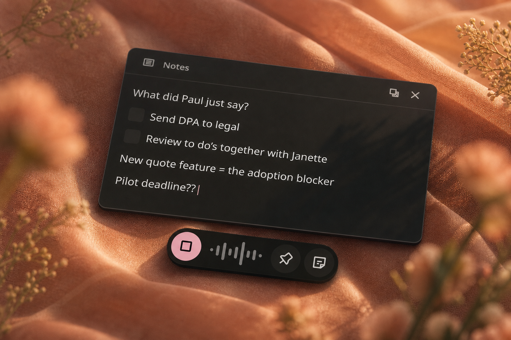

# Weeve Second Brain Template

*A working memory for you and your AI agents. Built at Weeve, shared openly.*

[Get started](docs/quickstart.md) · [Agent setup](docs/agents.md) · [Skills](skills/README.md) · [Connect your tools](docs/connections.md) · [Daily & weekly reviews](docs/reviews.md) · [Sources & credits](docs/architecture.md)

---

## A note from Stefan

I'm Stefan, co-founder of Weeve. I actively use a company second brain to work with customer conversations, product feedback and project decisions. It helps me prepare follow-ups, recover the context behind a decision and review what needs attention each week.

We benefited from people sharing their systems. This template is our contribution. We hope coaches, freelancers and teams can use it, adapt it and bring back what they learn.

## How the brain works

Keep the original evidence. Turn it into short, linked wiki pages. Let agents retrieve the relevant context when they work.

```text
Conversations + documents + analytics
                 ↓
        Private source evidence
                 ↓
        Proposed wiki update
                 ↓
         Your review and decision
                 ↓
        Approved shared knowledge
                 ↓
       Better context for the next task
```

Markdown holds the knowledge. Python handles imports, citations and approval records. Shared instructions guide Codex, Claude Code and other coding agents. Each task loads only relevant context.

Daily briefs surface priorities. Weekly reviews bring customer evidence to research, marketing, sales, product, delivery and strategy agents. Their recommendations become one decision agenda. [The workflow](docs/reviews.md).

## Start with your conversations

Weeve records, transcribes and summarises conversations on your Mac, so you can stay in the conversation. It supplies the evidence in my own second-brain setup. [Meet Weeve](https://getweeve.io/).



Weeve's recording controls and quick notes. [Image and brand rights](assets/README.md).

**Make your work legible to AI.** Write down goals, owners and decisions. Capture as much useful conversation context as participants' permission and your data policy allow. Customer interviews, project discussions and your own voice notes are good starting points.

To connect Weeve, record a permitted conversation, review it and copy or export a `.txt` or `.md` excerpt into your private workspace. Import it, then ask your agent for a cited wiki update. [Weeve setup](docs/conversations.md).

Keep local processing selected for confidential material. If a cloud coding agent reads a transcript, that text can reach its provider. Choose the permitted processor before importing real conversations. [Data boundaries](docs/privacy.md).

## Keep judgment with the human

You choose the goals, the evidence agents may use and the decisions that matter. Agents can flag a contradiction or draft an update. **You review the exact change before it becomes approved knowledge.**

Approval records bind the proposed content; they do not authenticate a person. For stronger separation, keep the approved workspace outside the proposing agent's write access. [How to do that](docs/safety.md).

Keep human approval for sensitive information, spending and commitments. Review corrections too, so later tasks can use what you learned.

## Try it locally

Download the ZIP or create a **private** copy with GitHub's template button. Install Python 3.9+, open the folder in a terminal and run

```sh
# Mac / Linux
python3 demo.py
python3 brain.py init
```

```powershell
# Windows
py -3 demo.py
py -3 brain.py init
```

The demo uses fictional coaching, freelance and organization examples. Your new `workspace/` is excluded from Git by default. Before real imports, choose the permitted processor using [the setup guide](docs/quickstart.md).

Open the folder in your coding agent, start with the [shared instructions](AGENTS.md), and paste

> Read AGENTS.md and docs/quickstart.md. Help me configure this for my work. Confirm processor permissions, start with one permitted source, and prepare one cited wiki update for my review.

Add PostHog, Google Analytics or another MCP/API connection when needed. Keep credentials in your host's secret store or ignored local settings. [Setup](docs/quickstart.md) · [Connections](docs/connections.md) · [Compatibility](docs/compatibility.md).

## Built on shared ideas

Andrej Karpathy's LLM Wiki shaped the knowledge layer. Tim Scheuer's OXYGEN walkthrough and Matt Paige's practical guide helped translate that pattern into a working routine. [Karpathy](https://gist.github.com/karpathy/442a6bf555914893e9891c11519de94f) · [OXYGEN](https://www.linkedin.com/posts/tim-scheuer-91b005237_we-built-a-company-wide-second-brain-for-activity-7476288218125021184-nj4V) · [Matt Paige](https://mattpaige68.substack.com/p/andrej-karpathy-just-showed-us-how).

Two talks worth watching are Tom Blomfield's **How to Build a Self-Improving Company with AI** and Garry Tan's **Every company should have a Brain**. Garry, YC's President and CEO, also shares his GBrain implementation. [Tom's YC talk](https://www.youtube.com/watch?v=X_JsIHUfUjc) · [Garry's talk](https://www.youtube.com/watch?v=eBUyTS7SzV4) · [GBrain](https://github.com/garrytan/gbrain).

---

Use it, adapt it, share what works. [MIT license](LICENSE) · [Contribute](CONTRIBUTING.md) · [Security](SECURITY.md)
